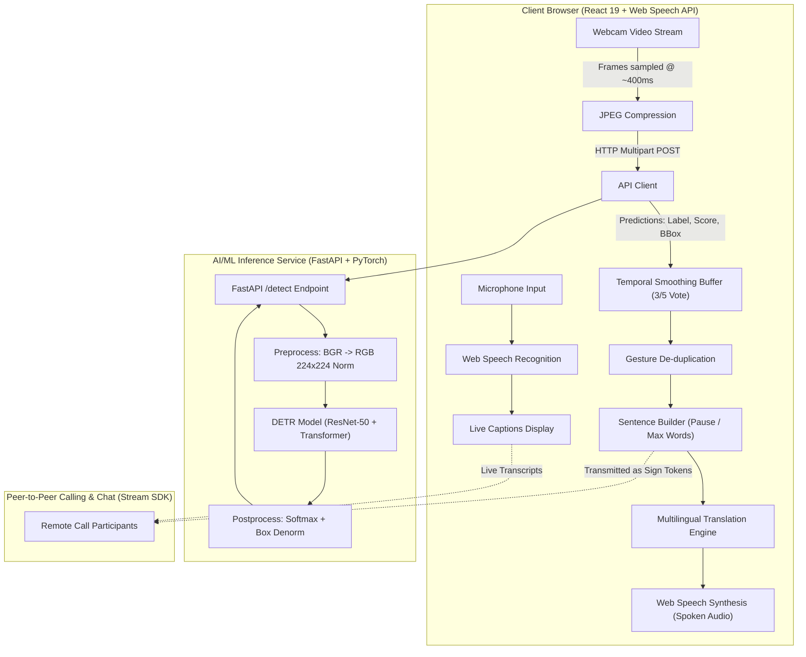

# 🤟 Fluent Meet — Real-Time Sign Language ⇄ Speech Translator & Video Calling Platform

> **Neural Storm 2026 · 48-Hour AI/ML Hackathon**  
> **Track 1: Future Tech — Intelligent Systems & Emerging Technology**  
> **Problem Statement FT-04 — Sign Language to Text/Speech Translator**  
> **Submission Deadline:** November 4, 2026 · 8:00 PM IST

---

## 📌 Project Overview & Team Information

| Attribute | Details |
| :--- | :--- |
| **Project Title** | Fluent Meet — Two-Way Sign Language to Speech & Live Captioning Platform |
| **Track** | Track 1: Future Tech (Intelligent Systems & Emerging Technology) |
| **Problem Statement** | **FT-04: Sign Language to Text/Speech Translator** |

---

## 🎯 The Problem

According to India's Ministry of Health & Family Welfare (National Programme for Prevention and Control of Deafness) and WHO surveys, **over 63 million individuals (approx. 6.3% of the population)** suffer from significant hearing impairment. 

In everyday scenarios—such as medical appointments, public services, banking, classrooms, and online video meetings—communication barriers create immense friction:
- **Scarcity & Cost of Interpreters:** Professional sign language interpreters are limited, costly, and unavailable on short notice.
- **Asymmetric Knowledge:** Over 99% of hearing individuals do not understand sign language.
- **Lack of Natural Two-Way Tools:** Most existing detectors simply spit out noisy single-word bounding boxes in real time rather than forming fluent, spoken natural language sentences with reverse captions.

FT-04 challenges participants to build an intelligent, functional, and accessible AI solution bridging sign language to text and speech.

---

## 💡 The Proposed Solution: Fluent Meet

**Fluent Meet** is a real-time, browser-native, two-way communication bridge powered by deep learning:

1. **Sign → Text → Speech (Deaf to Hearing):**
   - The user's webcam feed streams frame samples to a **PyTorch DETR** (DEtection TRansformer) model.
   - An intelligent **sliding-window temporal consensus algorithm** filters noisy frame flicker (requires 3 concordant votes across 5 frames).
   - A **gesture de-duplication layer** prevents continuous repetition while holding a sign.
   - A **sentence builder** buffers detected signs and synthesizes them into natural phrases once the signer pauses (2.5 seconds or 6 words).
   - High-quality **Text-to-Speech (TTS)** speaks the generated sentence aloud in real time using the Web Speech API.
2. **Speech → Live Captions (Hearing to Deaf):**
   - Built-in speech-to-text listens to the hearing speaker and projects instant live captions on screen for the deaf user.
3. **Multilingual Localization:**
   - Sign concepts are translated across 4 supported languages: **English**, **हिन्दी (Hindi)**, **मराठी (Marathi)**, and **Español (Spanish)**.
4. **Real-Time Video Conferencing & Collaborative Calling:**
   - Integrated with Stream Video & Chat SDKs, allowing deaf and hearing participants to conduct remote video calls where signs and captions stream seamlessly across peers.

---

## 🔬 What Makes This More Than a Simple Object Detector?

Standard computer-vision demos stop at detecting bounding boxes per frame. Fluent Meet implements a multi-layered end-to-end translation pipeline:

| Pipeline Layer | Technical Function | Code Location |
| :--- | :--- | :--- |
| **AI Detector** | Compact DETR (ResNet-50 backbone + 1 transformer encoder/decoder, 25 object queries) predicting hand signs with bounding boxes | [`Model/src/model.py`](Model/src/model.py), [`Model/src/inference.py`](Model/src/inference.py) |
| **Temporal Smoothing** | Sliding window voting buffer (size $K=5$, threshold $M=3$) eliminating single-frame classification flicker | [`Frontend/src/lib/signTranslator.js`](Frontend/src/lib/signTranslator.js) |
| **Gesture De-duplication** | State machine ensuring prolonged poses emit only once; requires hand clearance before re-triggering | [`Frontend/src/lib/signTranslator.js`](Frontend/src/lib/signTranslator.js) |
| **Sentence Aggregator** | Natural pause detection (2.5s timer or 6-word threshold) automatically grouping words into cohesive sentences | [`Frontend/src/lib/signTranslator.js`](Frontend/src/lib/signTranslator.js) |
| **Multilingual Phrasebook** | Maps standardized sign symbols to localized phrasing in English, Hindi, Marathi, and Spanish | [`Frontend/src/lib/phrases.js`](Frontend/src/lib/phrases.js) |
| **Two-Way Audio** | Browser-native Web Speech Synthesis (TTS) and Web Speech Recognition (STT) without paid API keys | [`Frontend/src/lib/speech.js`](Frontend/src/lib/speech.js) |
| **Evaluation Suite** | Formal mAP@IoU, per-class Precision/Recall/F1, Confusion Matrix, and CPU latency profiler | [`Model/src/evaluate.py`](Model/src/evaluate.py) |

---

## 📐 System Architecture



---

## 🛠️ Technology Stack

### 1. AI & Machine Learning Component (Python Primary)
- **Programming Language:** Python 3.12 / 3.13
- **Deep Learning Framework:** PyTorch (`torch 2.x`), `torchvision` (ResNet-50 backbone)
- **Model Architecture:** Custom compact DETR (DEtection TRansformer with 1 encoder layer, 1 decoder layer, 25 object queries)
- **Data Augmentation & Computer Vision:** OpenCV (`cv2`), Albumentations, NumPy
- **Serving & Microservice:** FastAPI, Starlette, Uvicorn (ASGI server)
- **Validation & Testing:** Pytest, AnyIO

### 2. Frontend Application
- **Framework:** React 19, Vite 7
- **Styling:** Tailwind CSS 4, Lucide React icons
- **State & Routing:** React Router 7, TanStack React Query
- **Voice & Accessibility:** HTML5 Web Speech API (SpeechSynthesis & SpeechRecognition)
- **Audio Feedback & Toast Notifications:** React Hot Toast

### 3. Video Calling & Signaling Backend (Optional)
- **Platform:** Express 5, Node.js 22
- **Real-Time Streaming:** Stream Video SDK & Stream Chat SDK for Web

---

## 🚀 Step-by-Step Instructions: Running Locally

### Prerequisites
- **Python:** Version 3.12 or 3.13 installed (`python --version`)
- **Node.js:** Version 20+ or 22 installed (`node --version`, `npm --version`)
- **Webcam & Microphone:** Connected and enabled in browser

---

### Step 1: Clone the Repository

```bash
git clone https://github.com/<YOUR_USERNAME>/<YOUR_REPO_NAME>.git
cd <YOUR_REPO_NAME>
```

---

### Step 2: Run the Model API Service (Python)

The Model API downloads the pretrained model checkpoint (`4426_model.pt`, ~108 MB) automatically on first run:

```bash
cd Model

# 1. Install dependencies
pip install -r requirements.txt

# 2. Start the FastAPI server (Port 7860)
python -m uvicorn api:app --app-dir src --host 127.0.0.1 --port 7860
```

> **Verification:** Open `http://127.0.0.1:7860/health` in your browser. You will see:
> ```json
> {
>   "status": "ok",
>   "model_loaded": true
> }
> ```
> Interactive Swagger API docs are available at `http://127.0.0.1:7860/docs`.

---

### Step 3: Run the Frontend (React + Vite)

Open a new terminal window:

```bash
cd Frontend

# 1. Create your local environment configuration
# Copy the example or create .env:
echo VITE_DETECT_URL=http://localhost:7860/detect > .env

# 2. Install dependencies
npm install

# 3. Start the Vite development server
npm run dev
```

> **Launch the App:** Open `http://localhost:5173/translator` in **Google Chrome** or **Microsoft Edge** (best support for Web Speech API).
> 1. Click **Start Camera** and grant browser camera permissions.
> 2. Perform the gestures: **`hello`**, **`iloveyou`**, or **`thankyou`**.
> 3. Watch the live bounding boxes and confidence score overlay.
> 4. Pause for ~2.5 seconds: the app automatically constructs the sentence and speaks it aloud!
> 5. Switch **Output Language** to Hindi, Marathi, or Spanish to hear the translated speech.
> 6. Enable **Live Captions** and speak into your microphone to verify the reverse speech-to-text path.

---

### Step 4 (Optional): Run the Video Calling Backend

*Only required if you want to test peer-to-peer video calls with chat.*

```bash
cd backend

# 1. Copy environment template and fill in Stream credentials
cp .env.example .env
# Edit .env and supply:
# STREAM_API_KEY=your_key
# STREAM_API_SECRET=your_secret

# 2. Install and launch
npm install
npm run dev     # Runs on http://localhost:5000
```

---

## 🧪 Comprehensive Automated Test Suites

All tests run locally and in GitHub Actions CI:

```bash
# Test the Python AI & Model Service (41 tests)
cd Model
python -m pytest

# Test the Frontend Translation Logic & Phrasebook (16 tests)
cd Frontend
npm test

# Check Backend Syntax
cd backend
node --check src/server.js
```

### Verified Test Results Summary:
- **`Model/tests` (41 passing):** Bounding box math (`xywh` to `xyxy`), DETR loss computation, Hungarian bipartite matcher, dynamic class expansion, image preprocessing normalization, FastAPI endpoints, inference postprocessing.
- **`Frontend/tests` (16 passing):** 3-of-5 sliding window voting, gesture deduplication, pause flushing, maximum word threshold, cross-lingual phrase dictionary completeness.

---

## 📊 Model Performance & Specifications

### Architecture Specs
- **Model:** DEtection TRansformer (DETR)
- **Backbone:** ResNet-50 (Feature extractor, frozen early layers for low-latency CPU inference)
- **Transformer Engine:** 1 Encoder layer, 1 Decoder layer, 25 Queries
- **Input Resolution:** $224 \times 224$ pixels, ImageNet normalized
- **Active Detection Classes:** `hello`, `iloveyou`, `thankyou` (expandable to 12+ signs using [`docs/ADD_SIGNS.md`](docs/ADD_SIGNS.md))
- **Confidence Threshold:** $0.90$ (eliminates background noise and false positives)

### Real-Time CPU Benchmarks
Tested on standard multi-core CPU (no GPU required):
- **Median Inference Latency:** $\sim 310 - 330\text{ ms}$ per frame
- **Streaming Sample Rate:** $\sim 2.5\text{ frames per second}$ (1 frame every $400\text{ ms}$)
- **Bandwidth Footprint:** Compressed JPEG frame payloads ($< 35\text{ KB}$ per request)
- **Client Processing Overhead:** $< 2\text{ ms}$ for temporal voting & sentence builder

---

## 🌐 Cloud Deployment Architecture

Detailed instructions are provided in [`docs/DEPLOY.md`](docs/DEPLOY.md).

```
[Vercel: Frontend (React 19)] 
     │
     ├── HTTPS POST /detect ──> [Hugging Face Spaces: Docker CPU (FastAPI + PyTorch)]
     │
     └── WebSocket / WebRTC ──> [Stream Video & Render: Calling Backend]
```

1. **AI Model Microservice (Hugging Face Spaces):**
   - Deployed as a Dockerized CPU container (`Model/Dockerfile`) on port `7860`.
   - Set environment variable `ALLOWED_ORIGINS` = `https://<YOUR-VERCEL-APP>.vercel.app,http://localhost:5173`.
2. **Frontend Application (Vercel):**
   - Import GitHub repository with root directory set to `Frontend`.
   - Set environment variable `VITE_DETECT_URL` = `https://<YOUR-HF-SPACE>.hf.space/detect`.
3. **Backend Service (Render):**
   - Deployed as a Web Service with root directory `backend`, build command `npm install`, start command `npm start`.

---

## ⚠️ Known Limitations & Future Roadmap

### Current Limitations
1. **Static Gesture Focus:** Recognizes 3 primary static hand signs (`hello`, `iloveyou`, `thankyou`). Real sign language involves facial expressions, hand motion trajectories, and spatial grammar.
2. **Per-Frame Detection:** Operates on isolated video frames rather than continuous temporal video sequences.
3. **Voice Availability:** Hindi/Marathi speech synthesis quality depends on OS/browser voice pack support.

### Roadmap & Next Steps
- [ ] **Dynamic Landmark Model:** Integrate Google MediaPipe 21-hand landmark extraction paired with a lightweight LSTM/GRU or Temporal Transformer to recognize moving signs and fingerspelling.
- [ ] **Indian Sign Language (ISL) Expansion:** Expand dataset to cover everyday medical and emergency conversational vocabularies.
- [ ] **Edge On-Device Inference:** Quantize model to ONNX / TensorFlow.js / WebAssembly to run entirely client-side without network requests.

---

## 🤖 Disclosure of AI Tools Used

In compliance with Neural Storm 2026 hackathon submission guidelines, the following AI development tools were utilized during the 48-hour hackathon period:
- **Antigravity (Google):** Used for architectural scaffolding, pair-programming the sliding-window temporal smoothing algorithms, authoring automated test suites (`signTranslator.test.js` and `test_metrics.py`), and documentation structuring.
- **GitHub Copilot:** Used for code completions in React UI components and FastAPI request validation boilerplate.

*All models, architectures, algorithmic pipelines, and source code were verified, customized, executed, and benchmarked by the project team.*

---

## 📄 License & Attribution

- Built during **Neural Storm 2026** (Track 1: Future Tech · Problem Statement FT-04).
- Model weights and architecture: PyTorch DETR.
- Open-sourced under the **MIT License**.
