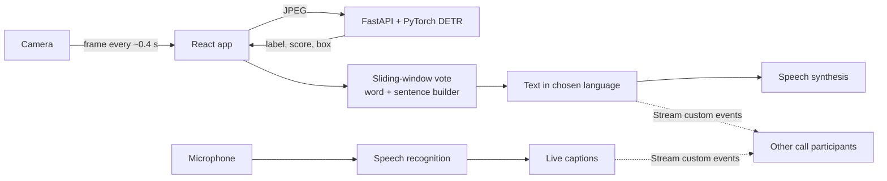

# 🤟 Fluent Meet — Sign Language ⇄ Speech, in real time

**Neural Storm 2026 · Track 1: Future Tech · Problem statement FT-04 — Sign Language to Text/Speech Translator**

| | |
| --- | --- |
| **Team** | `TODO: team name` |
| **Members** | `TODO: member 1, member 2, member 3` |
| **Live demo** | `TODO: https://your-app.vercel.app/translator` |
| **Model API** | `TODO: https://your-space.hf.space/docs` |

> Screenshots / demo GIF: `TODO: add docs/demo.gif and docs/screenshot-translator.png, then uncomment below`
> <!--  -->

---

## The problem

India's Ministry of Health (National Programme for Prevention and Control of Deafness) cites a WHO-protocol
estimate of about **63 million people (6.3%) with significant hearing impairment** — an older survey, but still the
official reference ([source](https://dghs.mohfw.gov.in/national-programme-for-prevention-and-control-of-deafness.php)).
Most hearing people don't know any sign language, and interpreters are scarce and expensive, so everyday
conversations — a clinic visit, a shop, a video call — become a barrier. FT-04 asks for a system that turns sign
language into text and speech.

## Our solution

Fluent Meet is a **two-way communication bridge** that runs in the browser:

1. **Sign → text → speech.** The camera feed is analysed by a PyTorch DETR model; a temporal layer turns
   noisy per-frame detections into stable words, groups them into sentences, and speaks them aloud.
2. **Speech → live captions.** What the hearing person says appears as text for the deaf person.
3. **Many languages.** Output can be English, हिन्दी, मराठी or Español — the same sign is spoken in the
   listener's language.
4. **Works in video calls.** In a call, every participant sees *and hears* the other's signs and captions in
   **their own** language (captions are sent as sign labels, not text, so each side translates locally).

### What makes it more than "a detector with a label"

| Layer | What it does | Where |
| --- | --- | --- |
| Detector | DETR (ResNet-50 + transformer) finds the hand sign and classifies it | `Model/src/model.py`, `inference.py` |
| Temporal smoothing | A sign must win 3 of the last 5 frames, so single-frame flicker is ignored | `Frontend/src/lib/signTranslator.js` |
| Gesture de-duplication | Holding a sign speaks it once; repeating needs the hand lowered | same |
| Sentence builder | Words become one sentence after a 2.5 s pause (or 6 words) | same |
| Phrase book | Sign → natural text in 4 languages | `Frontend/src/lib/phrases.js` |
| Speech out / in | Browser Web Speech API (no keys, no server) | `Frontend/src/lib/speech.js` |
| Evaluation | mAP, per-class P/R/F1, confusion matrix, latency | `Model/src/evaluate.py` |

## Architecture



## Technology stack

- **AI / ML (Python 3.12):** PyTorch, torchvision (ResNet-50), a small DETR (1 encoder + 1 decoder layer, 25 queries),
  Albumentations, OpenCV, NumPy, FastAPI, Uvicorn
- **Frontend:** React 19, Vite 7, Tailwind 4, React Router 7, Web Speech API (synthesis + recognition)
- **Calls & chat:** Stream Video + Chat SDKs, Express 5 backend (guest sessions and tokens)
- **Quality:** pytest (model + metrics), `node --test` (translation logic), GitHub Actions CI
- **Deployment:** Vercel (frontend), Hugging Face Spaces / Docker (model API), Render (backend)

## Quick start

The **translator page needs only the model API** — no Stream account.

```bash
# 1. Model API (http://localhost:7860) — Python 3.12
cd Model
pip install -r requirements.txt
python -m uvicorn api:app --app-dir src --port 7860      # downloads the weights on first start

# 2. Frontend (http://localhost:5173)
cd Frontend
cp .env.example .env                            # set VITE_DETECT_URL=http://localhost:7860/detect
npm install && npm run dev
# open http://localhost:5173/translator  (use Chrome or Edge for live captions)
```

Video calls and chat additionally need a free [Stream](https://getstream.io) app:

```bash
cd backend && cp .env.example .env              # STREAM_API_KEY + STREAM_API_SECRET
npm install && npm run dev                      # http://localhost:5000
# and set VITE_STREAM_API_KEY in Frontend/.env
```

### Using it

1. Open `/translator`, click **Start camera**, allow access.
2. Sign **hello**, **I love you** or **thank you**. The sentence builds up under *Live translation* and is
   spoken when you pause. Change **Output language** to hear it in Hindi, Marathi or Spanish.
3. Switch on **Live captions** and speak: your words appear as text for the other person.
4. No camera handy? The **simulated signs** buttons test the text-to-speech pipeline.

## Model performance

Generate the numbers on your own test split (they are written to `Model/results/`):

```bash
cd Model
pip install -r requirements-dev.txt
python src/evaluate.py --checkpoint pretrained/4426_model.pt --data data/test
```

`TODO: paste Model/results/metrics.md here after running the command above`

<!-- Example of what the script prints (NOT our results): mAP@0.5, per-sign AP / precision / recall / F1,
     confusion matrix image, median and p95 CPU latency. -->

## Tests

```bash
cd Model    && python -m pytest          # API, model, loss, boxes, inference, data, metrics, add_signs
cd Frontend && npm test                  # sign translator: voting, de-duplication, sentences, languages, config sync
```

## Configuration

**backend `.env`** — `STREAM_API_KEY`, `STREAM_API_SECRET` (required); `PORT`, `CORS_ORIGIN` (optional).
**Frontend `.env`** — `VITE_STREAM_API_KEY` (calls only); `VITE_API_URL`, `VITE_DETECT_URL` (optional overrides).
**Model API** — `MODEL_PATH`, `MODEL_URL`, `SCORE_THRESHOLD` (0.90), `MAX_DETECTIONS` (5), `MAX_UPLOAD_BYTES` (5 MB),
`ALLOWED_ORIGINS` (comma-separated; add your deployed frontend URL).

## Model API

- `GET /health` → `{ "status": "ok", "model_loaded": true }`
- `POST /detect` (form field `file`: JPEG/PNG) → `{ "detections": [{ "class_id", "label", "score", "bbox": [x1,y1,x2,y2] }], "inference_ms" }`

## Training more signs

Translations for 9 further signs (`stop yes no good ok water help please sorry`) are already in the phrase book.
To make the model recognise them you need labelled images and a fine-tune — full runbook in
[`docs/ADD_SIGNS.md`](docs/ADD_SIGNS.md):

```bash
python src/utils/add_signs.py stop yes good ok water                 # config.json + frontend in sync
python src/utils/collect_images.py --only stop yes good ok water     # capture
python src/train.py --resume pretrained/4426_model.pt --expand-head  # fine-tune, keeping the old signs
python src/evaluate.py --checkpoint checkpoints/best_model.pt        # metrics for this README
```

## Deployment

Step-by-step: [`docs/DEPLOY.md`](docs/DEPLOY.md).

- **Frontend** → Vercel (`Frontend/vercel.json`). **Backend** → Render or Vercel (`backend/vercel.json`).
- **Model API** → any Docker host, e.g. a Hugging Face Space (`Model/Dockerfile`, CPU-only PyTorch, port 7860).

## Limitations (honest ones)

- Recognises **3 static signs** in the shipped model (`TODO: update if you trained more`) (`hello`, `iloveyou`, `thankyou`). Real sign languages also use motion,
  facial expression and grammar; this is a working foundation, not a full translator.
- A frame is analysed independently, so fast or moving signs are not captured yet.
- Live captions need Chrome, Edge or Safari; voices for Hindi/Marathi depend on the device.

## Roadmap

More signs and an Indian Sign Language vocabulary; hand-landmark + temporal model (e.g. MediaPipe + LSTM/Transformer)
for moving signs and fingerspelling; on-device inference to remove the server round-trip.

## Disclosure of AI tools

This project was developed with AI assistance. **Claude (Anthropic)** helped write the sign-to-sentence
translation layer, speech/caption integration, the evaluation script and tests, and this documentation.
`TODO: list any other tools you used (ChatGPT, Copilot, Cursor …) and which parts they touched.`
All code was reviewed and run by the team.

## Credits

`TODO: credit the origin of the detector weights, the dataset, and anything reused. Model weights default to
the URL in Model/src/api.py (MODEL_URL).`
